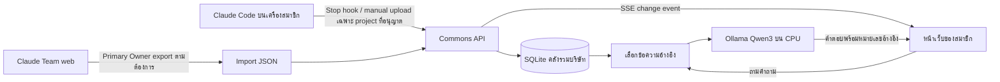

# Commons: คู่มือติดตั้งและดูแลระบบ On-premises

ปรับปรุง: 29 ตุลาคม 2026 · เป้าหมาย: บริษัทที่มี CPU server ไม่มี GPU

## 1. ผลลัพธ์และขอบเขต

ชุดนี้มี frontend เดียวกับเว็บตัวอย่าง แต่เพิ่ม backend Node.js 24 ที่รันบนเครื่องบริษัท, SQLite แบบ WAL, บัญชีสมาชิก, คลังร่วมของบริษัท, ingestion token, live updates ผ่าน Server-Sent Events และการตอบคำถามด้วย Ollama ภายในเครื่อง/เครือข่ายบริษัท

เว็บ Sites ที่เผยแพร่ไว้ยังเป็นพื้นที่ส่วนตัวของ Organizer ไม่ใช่เซิร์ฟเวอร์บริษัท และไม่สามารถเข้าถึง `localhost` หรือ private LAN ของบริษัทได้เอง การวางระบบนี้ต้องติดตั้งชุด on-prem แยกต่างหากและเปิดชื่อ DNS ภายในให้สมาชิกเข้า

| ความสามารถ | ทำแล้วในโค้ดนี้ | ขอบเขต |
|---|---|---|
| Settings | รวมหน้าตา, AI, connections, บัญชี | เลือกธีมและ API key ของเว็บตัวอย่างในหน้านี้ |
| บัญชีทีม | local username/password, admin/member | ยังไม่มี SSO, MFA, SCIM หรือ OIDC ของบริษัท |
| คลังกลาง | สมาชิกที่เข้าสู่ระบบเห็นแชตร่วมกัน | Project เป็นตัวกรอง ไม่ใช่ ACL |
| นำเข้า | JSON, JSONL, TXT, Markdown | แตก ZIP เอง; ไม่อ่าน PDF/รูปภาพ/ไฟล์แนบ |
| Claude Team web | นำเข้า official organization export | ไม่ใช่ live sync และไม่เรียก internal API |
| Claude Code | opt-in Stop hook หรือส่งไฟล์ด้วยคำสั่ง | ส่งเฉพาะ approved project / approved transcript root |
| Live UI | SSE หลังมี import, delete หรือเปลี่ยนงาน | ไม่ได้ดึงข้อมูลที่ยังไม่ส่งออกมาจาก Claude |
| AI ในบริษัท | Ollama native `/api/chat` | ไม่มี paid fallback; server ต้องโหลดโมเดลก่อน |
| ความรู้ใหม่ | retrieval จากข้อมูลที่รับเข้ามา | ไม่ปรับ weights ไม่ fine-tune อัตโนมัติ |
| Tasks | สร้าง, มอบหมายชื่อ, เปลี่ยนสถานะ | ไม่ส่งอีเมล/ข้อความแจ้งเตือนให้ผู้รับผิดชอบ |

## 2. เหตุใดไม่มี Claude OAuth สำหรับอ่านแชต

เอกสาร [Authentication and credential use ของ Anthropic](https://code.claude.com/docs/en/legal-and-compliance#authentication-and-credential-use) ระบุข้อจำกัดการนำ Claude.ai login มาไว้ในแอปภายนอกและการเก็บ/ส่งต่อ session credentials จึงไม่ได้สร้าง OAuth client ปลอมหรืออ่าน credentials ของ Claude Code มาใช้ใน Commons

OAuth ของ MCP connector เป็นคนละทิศทาง: ให้ Claude เข้าถึงบริการของคุณ ไม่ใช่ให้บริการของคุณอ่านแชต Claude ทั้งองค์กร การมีบัญชี Organizer/Owner ไม่ได้ทำให้มีสิทธิ์เรียก chat-history API ผ่าน OAuth โดยอัตโนมัติ

เส้นทางที่ใช้กับ Claude Team ได้คือ [Organization data export](https://support.claude.com/en/articles/13346720-export-your-organization-s-data) โดย Primary Owner หรือให้ Owner เปิดสิทธิ์ export รายบุคคล ผู้ใช้ยังต้องเข้า Claude ด้วย flow ของ Anthropic เอง

หากองค์กรต้องการ programmatic extraction จริง ให้ประเมิน [Enterprise Compliance API](https://platform.claude.com/docs/en/manage-claude/compliance-api) และสิทธิ์ read ที่เหมาะสม Connector นี้ยังไม่ได้ implement ในชุดนี้ ไม่ควรแสดงว่าเชื่อมแล้วก่อนมี credential และทดสอบ pagination/retention จริง

## 3. Data flow และความหมายของ real-time



คำว่า live ในชุดนี้หมายถึงหลัง backend รับและบันทึกข้อมูลสำเร็จ จะส่ง change event ให้หน้าเว็บที่เชื่อมอยู่ แล้วหน้าเว็บอ่านข้อมูลล่าสุดใหม่ ไม่มีการอ้างเวลาเป็น SLA เพราะขึ้นกับเครือข่าย ขนาดไฟล์ และความเร็ว disk

Claude Code hook ส่งหลังจบคำตอบ ไม่ได้ส่ง token ทุกตัวขณะที่กำลัง generate และไม่ใช่ background crawler ที่ติดตามทุกโปรเจกต์อย่างเงียบ ๆ หากไม่ต้องการส่งต่อเนื่อง ตั้ง `enabled: false` หรือไม่ติดตั้ง hook แล้วใช้ manual command เฉพาะครั้งได้

เมื่อบริษัทปิดเครือข่ายหรือเซิร์ฟเวอร์ล่ม collector ไม่ขัดจังหวะ Claude Code ข้อมูลยังอยู่ใน local session file การส่งซ้ำเกิดที่ Stop ถัดไปหรือ manual retry ไม่มี durable retry queue บนเครื่องสมาชิก

## 4. Server requirements สำหรับ CPU-only

ตัวเลขต่อไปนี้เป็น **ข้อเสนอสำหรับวางแผนของระบบนี้** ไม่ใช่ throughput ที่ benchmark แล้วบนเครื่องคุณ จำนวนสมาชิกที่เปิดเว็บพร้อมกันต่างจากจำนวนผู้ถาม AI พร้อมกัน

| ระดับ | CPU | RAM | Storage | AI พร้อมกัน | โมเดลเริ่มต้น |
|---|---|---|---|---|---|
| ทดลองขนาดเล็ก | 4 physical cores หรือ 8 vCPU ที่ไม่ overcommit มาก | 16 GB | SSD 100 GB | 1 | Qwen3 4B Q4 |
| แนะนำสำหรับ pilot ทีม | 8 physical cores หรือประมาณ 16 vCPU | 32 GB | NVMe 250 GB + backup แยก | 1 | Qwen3 4B; ประเมิน 8B ภายหลัง |
| ทีมที่มีข้อมูลมากขึ้น | 12–16 physical cores, RAM bandwidth ดี | 64 GB | NVMe 500 GB + backup แยก | ยังเริ่ม 1 | ทดสอบ 8B และ retrieval ก่อนเพิ่ม concurrency |

ข้อพิจารณา:

- แนะนำ Linux x86-64 รุ่นที่องค์กรดูแล เช่น Ubuntu Server LTS หรือ Debian stable และ CPU ที่รองรับ AVX2 สำหรับเส้นทาง CPU ทั่วไป ต้องทดสอบ build กับสถาปัตยกรรมจริง
- vCPU จาก hypervisor ไม่เท่ากับ physical core ระวัง CPU overcommit, power-saving และ NUMA ข้าม socket
- CPU inference มักขึ้นกับ memory bandwidth และขนาดโมเดลมากกว่าจำนวน core เพียงอย่างเดียว
- 16 GB เป็นจุดเริ่มทดลอง อย่าแบ่ง RAM ทั้งหมดให้ Ollama ต้องเหลือ OS, Docker, page cache, SQLite และช่องว่างระหว่าง import
- ไม่แนะนำให้ใช้ swap เป็นหน่วยความจำหลักของโมเดล ถ้ามี swap หนัก คำตอบอาจช้าจน timeout
- ไม่ให้สัญญาว่าจะตอบเร็วเท่า Claude ที่ให้บริการบนคลาวด์ โดยเฉพาะภาษาไทยและคำถามยาว
- GPU ไม่จำเป็นสำหรับค่าเริ่มต้น ไม่ต้องติดตั้ง NVIDIA Container Toolkit สำหรับชุด CPU นี้
- ถ้าเป็น Windows Server ให้ประเมิน Linux VM ที่องค์กรดูแล ชุด Compose นี้ออกแบบให้ Linux เป็นเป้าหมายหลัก ไม่ใช่ Windows containers

### 4.1 Model ที่เลือกและต้นทุน

ตั้งต้น `qwen3:4b` ผ่าน Ollama เป็นโมเดล multilingual ขนาดเล็ก หน้า [Ollama Qwen3 4B](https://ollama.com/library/qwen3:4b) ระบุไฟล์ Q4_K_M ประมาณ 2.5 GB และ Apache 2.0 license ส่วน [8B](https://ollama.com/library/qwen3:8b) ประมาณ 5.2 GB ขนาดไฟล์ไม่ใช่ RAM runtime ทั้งหมด ต้องเพิ่ม KV cache และ runtime overhead

ไม่มีค่า API รายครั้งสำหรับ local inference แต่ยังมีค่าไฟ เครื่อง storage และผู้ดูแล ไม่ต้องนำ key ของบริการภายนอกมาใส่ใน on-prem backend นี้ และ backend นี้ไม่ fallback ไป paid model ถ้า Ollama ล่ม

ค่าเริ่มต้นใน `onprem/model.ts`:

| ค่า | ปัจจุบัน | ผล |
|---|---|---|
| concurrent generation | 1 ต่อ Node process | คำขอที่ชนกันตอบ HTTP 429 ให้ลองใหม่ ไม่มีคิวถาวร |
| context | 8,192 tokens | ช่วยจำกัด RAM; ไม่ยัดทุกแชตเข้าคำถามเดียว |
| response limit | 1,024 tokens | จำกัดความยาว/เวลาตอบ |
| evidence | สูงสุด 8 ช่วง ช่วงละ 900 ตัวอักษร | เลือกบริเวณใกล้คำค้น |
| model timeout | 180 วินาที | จบคำขอที่นานเกินไป |
| keep_alive | 10 นาทีหลังคำถาม | โมเดลอาจ unload เมื่อไม่ได้ใช้ ไม่ต้องใช้ CPU ฝึกตลอดเวลา |
| thinking | false + `/no_think` | ลดงาน reasoning ที่ไม่จำเป็นในค่าเริ่มต้น |

การเปลี่ยนค่าระดับ request ต้องแก้ `onprem/model.ts` แล้ว build ใหม่ การเปลี่ยน environment ของ Ollama ไม่ได้ override request option ทุกตัว หากต้องการโมเดลอื่นให้ทดสอบการรองรับ `think`, ภาษาไทยและ citation ก่อน

### 4.2 Storage sizing

ข้อมูล normalized ถูกเก็บเป็น messages JSON และทำสำเนาเป็น retrieval chunks จึงไม่เท่ากับขนาด ZIP ต้นทาง ประเมินพื้นที่ดังนี้เป็น planning budget:

`พื้นที่ทั้งหมด ≈ image/build cache + model files + 3–6 × normalized chat text + WAL/headroom + backup retention`

ตัวคูณ 3–6 เป็นค่าเผื่อของการทำสำเนาข้อความ/metadata/overlap ไม่ใช่การวัดจริง ต้องนำเข้า pilot export แล้ววัด `.sqlite`, `-wal` และ backup จริง ใช้การเตือน disk ที่ 70/85% ตามมาตรฐานบริษัท และเว้นพื้นที่สำหรับ snapshot ก่อน upgrade

ห้ามวาง SQLite WAL บน SMB/NFS share หรือให้ app หลาย replicas เขียนไฟล์เดียวกัน ค่าเริ่มต้นนี้ใช้ **app replica เดียว + local SSD volume** หากต้อง scale มากกว่านี้ต้องย้าย storage/backend ไป PostgreSQL และ queue แทน

## 5. พอร์ต เครือข่าย และ DNS

| เส้นทาง | พอร์ต | เปิดให้ใคร |
|---|---|---|
| Browser / collector → Caddy | TCP 443 | เฉพาะ LAN/VPN บริษัทที่อนุญาต |
| Caddy → app | TCP 3000 ภายใน Compose | ไม่ publish ไป host |
| app → Ollama | TCP 11434 ภายใน Compose | ไม่ publish ไป LAN/Internet |
| download images / model | HTTPS outbound | เฉพาะช่วง provision/upgrade ที่อนุมัติ |

สร้าง DNS เช่น `commons.company.internal` ให้ชี้ไป LAN IP ของเซิร์ฟเวอร์ ตั้ง `PUBLIC_ORIGIN` ให้ตรงกับ URL จริง scheme/hostname/port เพื่อให้ CSRF check ทำงาน ต้องไม่อาศัยการปิด origin validation เพื่อแก้ปัญหา proxy

ไม่ควรเปิด Ollama ตรงให้ browser เรียก ไม่มีการส่ง ingestion token/API credential ไปโมเดล การเข้าฐานข้อมูลและ model routing ทำที่ backend

## 6. Quick start ด้วย Docker Compose บน Linux

### 6.1 ก่อนเริ่ม

1. ติดตั้ง Docker Engine และ Compose plugin จากแหล่งทางการตาม OS ของบริษัท
2. นำ source repository นี้เข้าเซิร์ฟเวอร์ เช่น `/srv/commons/source`
3. เตรียม internal DNS และ LAN IP
4. เตรียม backup destination แยกจาก data volume
5. ให้ผู้ดูแลระบบกำหนดผู้มีสิทธิ์ส่งข้อมูลเข้าสู่คลังร่วม

ตัวอย่างต่อไปนี้รันจาก root repository ไม่ใช่ในโฟลเดอร์ `deployment`:

```bash
cd /srv/commons/source
cp deployment/environment.example deployment/.env
mkdir -p deployment/secrets
chmod 700 deployment/secrets
```

แก้ `deployment/.env`:

```dotenv
COMMONS_HOST=commons.company.internal
BIND_IP=10.20.30.40
ADMIN_USER=admin
OLLAMA_MODEL=qwen3:4b
```

ค่า `BIND_IP=127.0.0.1` ในตัวอย่างเริ่มต้นใช้สำหรับทดสอบเฉพาะเครื่อง เปลี่ยนเป็น LAN IP ของเซิร์ฟเวอร์เพื่อให้สมาชิกเข้าถึงได้ ไม่จำเป็นต้องใช้ `0.0.0.0` ถ้าต้องจำกัด interface

### 6.2 สร้าง bootstrap password โดยไม่ใส่ใน command arguments

```bash
read -rsp 'Initial admin password (12+ characters): ' COMMONS_ADMIN_PASSWORD
printf '\n'
printf '%s' "$COMMONS_ADMIN_PASSWORD" > deployment/secrets/admin_password.txt
unset COMMONS_ADMIN_PASSWORD
sudo chown 1000:1000 deployment/secrets/admin_password.txt
sudo chmod 600 deployment/secrets/admin_password.txt
```

Runtime image ใช้ `node` UID 1000 เพื่ออ่าน secret นี้ อย่า commit secret/.env เข้า Git โฟลเดอร์ถูก ignore ใน repository และ Docker build context แล้ว

รหัสผ่านนี้ใช้เฉพาะ bootstrap เมื่อฐานข้อมูลยังไม่มี users การเปลี่ยนไฟล์ไม่ได้ reset บัญชีที่มีอยู่ หากลืมรหัสผ่านใช้ขั้นตอน recovery ด้านล่าง

### 6.3 ตรวจ config และเริ่มบริการ

```bash
docker compose --env-file deployment/.env -f deployment/compose.yaml config --quiet
docker compose --env-file deployment/.env -f deployment/compose.yaml up -d --build
docker compose --env-file deployment/.env -f deployment/compose.yaml ps
docker compose --env-file deployment/.env -f deployment/compose.yaml logs --tail=100 app
```

Compose จะสร้างบริการ `app`, `ollama`, `proxy` และ named volumes สำหรับข้อมูล คำสั่ง build ต้องดาวน์โหลด npm packages ขณะ build; image final ไม่ได้พก node_modules ทั้งชุดไปรัน backend

### 6.4 ดาวน์โหลดโมเดลบนเซิร์ฟเวอร์บริษัท

```bash
docker compose --env-file deployment/.env -f deployment/compose.yaml exec \
  -e OLLAMA_HOST=http://127.0.0.1:11434 ollama ollama pull qwen3:4b

docker compose --env-file deployment/.env -f deployment/compose.yaml exec \
  -e OLLAMA_HOST=http://127.0.0.1:11434 ollama ollama list
```

คำสั่งนี้ดาวน์โหลดจริงบนบริษัท เมื่อยังไม่ได้รันจะไม่มีไฟล์โมเดลอยู่ใน server การสร้าง source/Dockerfile ในงานนี้ไม่ได้แปลว่าดาวน์โหลดโมเดลบนเครื่องที่คุณยังไม่ได้ provision แล้ว

หลัง download เปิด Settings → AI และเซิร์ฟเวอร์ → ตรวจสอบสถานะ ควรเห็นบริการเข้าถึงได้และพบชื่อโมเดลตรง `qwen3:4b` คำว่าไฟล์โมเดลพร้อมใช้ไม่ได้ยืนยันว่าโมเดลกำลัง resident อยู่ใน RAM

## 7. HTTPS และ certificate trust

`deployment/Caddyfile` ตั้ง `tls internal` สำหรับ internal CA ของ Caddy ต้องนำ root CA ที่ถูกต้องให้ IT แจกจ่ายเข้าสู่ trust store ของเครื่องสมาชิก/Node collector ก่อนใช้ อย่ากด bypass browser warning และอย่าตั้ง `NODE_TLS_REJECT_UNAUTHORIZED=0`

อ่าน root certificate ผ่านช่องทาง admin:

```bash
docker compose --env-file deployment/.env -f deployment/compose.yaml exec proxy \
  cat /data/caddy/pki/authorities/local/root.crt > commons-root-ca.crt
```

ตรวจ fingerprint กับผู้ดูแลก่อนแจกจ่าย ไฟล์นี้เป็น public CA certificate ไม่ใช่ CA private key ห้ามแจกไฟล์อื่นทั้ง volume

สำหรับ collector ที่ใช้ Node และยังไม่อ่าน enterprise trust store ตั้ง `NODE_EXTRA_CA_CERTS=/path/to/commons-root-ca.crt` ในสภาพแวดล้อมที่เปิด Claude Code แล้วเริ่มโปรแกรมใหม่

ถ้ามี corporate certificate ให้ mount chain/private key แบบ read-only ใน proxy แล้วเปลี่ยนเป็น `tls /certs/fullchain.pem /certs/privkey.pem` ตามนโยบาย PKI ของบริษัท เก็บ private key ออกจาก Git และไม่ส่งให้สมาชิก

## 8. สร้างสมาชิกและเริ่มใช้

1. เปิด `https://commons.company.internal` หลัง trust certificate แล้ว
2. กด Settings → บัญชีและสมาชิก และเข้าสู่ระบบด้วย bootstrap admin
3. สร้าง username ของแต่ละคนกับรหัสผ่านเริ่มต้นอย่างน้อย 12 ตัวอักษร
4. ส่งรหัสผ่านผ่านช่องทางภายในที่ปลอดภัย ให้สมาชิกเปลี่ยนใน Settings เมื่อเริ่มใช้
5. อธิบายว่าข้อมูลที่นำเข้าจะมองเห็นได้โดยสมาชิกทุกคนในระบบนี้
6. ทดสอบด้วยข้อมูลสมมติ/ข้อมูลตัวอย่างก่อนนำเข้าข้อมูลใช้งานจริง

รหัสผ่านเก็บแบบ salted scrypt, sessions เป็น random bearer ที่เก็บ digest ในฐานข้อมูล, cookie เป็น HttpOnly/SameSite=Strict และ Secure เมื่อใช้ HTTPS อายุ session 12 ชั่วโมง

การปิดบัญชีจะทำให้ login ไม่ได้และ revoke sessions/ingestion tokens ของบัญชีนั้น ข้อมูลที่เคยส่งยังอยู่ในคลังกลาง ไม่ถูกลบอัตโนมัติ

ยังไม่มี MFA, SSO, forgot-password email, บังคับเปลี่ยนรหัสผ่านครั้งแรก หรือ self-service re-enable บัญชี ใช้ pilot ใน LAN/VPN ที่ควบคุมได้ก่อน และประเมิน SSO/MFA หากขยายขอบเขตผู้ใช้

## 9. นำข้อมูล Claude Team web เข้าเป็นครั้ง ๆ

1. Primary Owner เข้า Claude ตาม flow ของ Anthropic
2. Organization settings → Data and privacy → Export Data
3. รออีเมล ดาวน์โหลดและแตก ZIP
4. เลือก JSON ที่มี conversation records ไม่ใช่ users-only JSON
5. เปิด Commons → นำเข้าข้อมูล → เลือกไฟล์ → ตรวจจำนวนรายการ → ยืนยันสิทธิ์ → นำเข้า

หากไฟล์ไม่มีข้อมูล user/project ต้องระบุเอง การกรอกชื่อไม่ได้ตรวจว่าคนดังกล่าวเป็น author จริงใน Anthropic จึงเก็บ `owner` ที่เป็นบัญชีผู้นำเข้าไว้แยกเพื่อกำกับสิทธิ์ลบ

ไฟล์ที่มี uuid/id และ owner/person คงเดิมนำเข้าซ้ำจะอัปเดตรายการเดิม หากคนละบัญชี import export เดียวกันจะเป็นอีกสำเนา เพื่อไม่ให้สมาชิกหนึ่งทับข้อมูลของอีกคน แนะนำให้กำหนดผู้ดูแลนำเข้า organization export คนเดียว

การนำเข้าไม่ใช่ mirror การลบแชตใน Claude ไม่ได้ลบสำเนาใน Commons และการลบสำเนา Commons ไม่ได้ลบต้นทาง หากต้องทำ retention sync ต้องพัฒนาเพิ่ม

## 10. Claude Code: manual และ Stop-hook collector

อ้างอิง lifecycle และ `transcript_path` จาก [Claude Code Hooks](https://code.claude.com/docs/en/hooks) ไม่ได้อ่าน OAuth credential หรือ intercept คำตอบจาก Anthropic network

### 10.1 เตรียมไฟล์ collector ที่เครื่องสมาชิก

ให้สมาชิกใช้ Node.js 24+ และ copy `scripts/collectors/claude-code.mjs` กับ config ตัวอย่างไปตำแหน่งที่คงที่ สคริปต์ collector เป็น dependency-free ไม่จำเป็นต้องติดตั้ง project ทั้ง repository

ใน Settings → เชื่อมต่อข้อมูล สร้าง token ระบุชื่อเครื่อง token แสดงครั้งเดียว ต้องนำไปเก็บในไฟล์ที่อ่านได้เฉพาะเจ้าของเครื่อง

ตัวอย่าง Linux/macOS:

```bash
mkdir -p ~/.config/commons
chmod 700 ~/.config/commons
cp /path/to/claude-commons/scripts/collectors/claude-code.mjs ~/.config/commons/
cp /path/to/claude-commons/scripts/collectors/config.example.json ~/.config/commons/config.json
# ใช้ editor วาง token จาก Settings ลง ~/.config/commons/collector.token
chmod 600 ~/.config/commons/config.json ~/.config/commons/collector.token
```

แก้ config หลังจากยืนยันกับสมาชิกว่าจะส่งข้อมูลในโปรเจกต์นี้:

```json
{
  "enabled": true,
  "endpoint": "https://commons.company.internal",
  "person": "alice@company.internal",
  "tokenFile": "./collector.token",
  "projects": [
    {"path": "/home/alice/work/member-platform", "name": "Member platform"}
  ],
  "transcriptRoots": ["/home/alice/.claude/projects"]
}
```

ทุก path ต้องมีอยู่จริง สคริปต์ตรวจ realpath เพื่อกัน symlink ออกนอก allowlist อย่าอนุญาต home ทั้งหมดหรือ directory ของโปรเจกต์ส่วนตัว `person` เป็น label ที่สมาชิกตั้งเอง ไม่ใช่ identity ที่พิสูจน์กับ Claude

### 10.2 ส่งครั้งเดียวด้วยคำสั่ง

```bash
node ~/.config/commons/claude-code.mjs \
  --config ~/.config/commons/config.json \
  --file /home/alice/.claude/projects/PROJECT/session-id.jsonl \
  --project /home/alice/work/member-platform
```

Manual mode แสดงจำนวนที่นำเข้าหรือเหตุผลที่ข้าม และ exit 1 เมื่อ error ใช้เป็น acceptance test ก่อนเปิด hook

### 10.3 ติดตั้ง Stop hook

เพิ่มเฉพาะส่วนนี้เข้า `.claude/settings.json` ของโปรเจกต์ที่อนุญาต โดย merge กับ settings เดิม ไม่เขียนทับ hooks อื่น:

```json
{
  "hooks": {
    "Stop": [
      {
        "hooks": [
          {
            "type": "command",
            "command": "node /home/alice/.config/commons/claude-code.mjs --config /home/alice/.config/commons/config.json",
            "timeout": 12
          }
        ]
      }
    ]
  }
}
```

สคริปต์อ่าน stdin ของ hook แล้วตรวจ `hook_event_name`, `cwd`, `transcript_path` และ `stop_hook_active` หากเป็น continuation ของ Stop hook จะข้ามเพื่อลดการส่งซ้ำ

ใช้ absolute path ใน hook ถ้ามีช่องว่างต้อง quote ตาม shell ของเครื่องนั้น ตัวอย่าง Windows ที่ใช้ Node ที่ PATH และ path ไม่มีช่องว่าง:

```json
{
  "hooks": {
    "Stop": [{"hooks": [{
      "type": "command",
      "command": "node C:/CommonsCollector/claude-code.mjs --config C:/CommonsCollector/config.json",
      "timeout": 12
    }]}]
  }
}
```

config บน Windows ใช้ `C:/Users/ALICE/...` หรือ escape backslash ให้ถูกต้อง จำกัด NTFS ACL ของ `collector.token` ให้เจ้าของบัญชีและผู้ดูแลที่จำเป็น

### 10.4 สิ่งที่ส่งและสิ่งที่ไม่ส่ง

- ส่ง snapshot **ทั้งไฟล์ JSONL ที่เลือก** ใน session ที่ผ่าน allowlist ไม่ใช่เฉพาะข้อความสุดท้าย
- backend เก็บ human/assistant text และ usage ที่อ่านได้ ไม่ได้ส่ง `.credentials.json`, browser cookie หรือ OAuth token
- raw transcript ที่ส่งอาจมีข้อมูลธุรกิจ/tool text แม้ parser จะไม่เก็บทุก field จึงต้องเลือก project และทำข้อตกลงข้อมูลก่อน
- tool-only payloads, images และ attachments ไม่ถูกแปลงเป็นความรู้ในรุ่นนี้
- timeout upload 8 วินาที หากเครือข่ายไม่ทันให้ manual retry หรือใช้ไฟล์ย่อย
- token อายุ 90 วัน เพิกถอนได้จาก Settings และใช้ได้เฉพาะ `/api/ingest`
- ปิด `enabled` หรือเอา hook ออกเพื่อหยุดส่ง ไม่ได้ลบข้อมูลที่ส่งไปแล้ว
- ไม่มี background file watcher ที่ติดตั้งเอง ไม่มีการรวบรวมโปรเจกต์ที่ไม่อยู่ใน allowlist

## 11. AI เรียนรู้จากคลังอย่างไร

เมื่อมีคำถาม server อ่านสูงสุด 6,000 chunks ล่าสุดใน project/person scope แล้วจัดอันดับด้วยคำสำคัญไทย/อังกฤษ เลือกสูงสุด 8 ช่วงและตัดบริเวณรอบคำค้น ส่งหลักฐานพร้อมเลขอ้างอิงให้ Ollama

ข้อดีคือเพิ่มข้อมูลแล้วใช้เป็นความรู้ได้ทันทีและลบข้อมูลได้ง่าย ข้อจำกัดคือยังไม่มี embeddings/vector database, reranker, knowledge graph, verified memory facts หรือ online fine-tuning คำถามที่ใช้ศัพท์คนละคำกับต้นทางอาจค้นไม่เจอ และข้อมูลเก่าที่อยู่นอก 6,000 ช่วงล่าสุดอาจไม่ถูกพิจารณา

การสอนโมเดลจากทุกแชตโดยอัตโนมัติไม่ควรถูกอ้างว่าเสร็จแล้วในระบบนี้ ถ้าต้อง fine-tune ภายหลังให้แยก dataset ที่คัดกรอง secret/PII, versioned eval และ deployment process ออกจากฐานความรู้ สำหรับ CPU server ควรพัฒนา retrieval ก่อนลงทุนกับ training

## 12. API contract แบบย่อ

| Endpoint | Auth | การใช้งาน |
|---|---|---|
| `GET /healthz` | ไม่ต้อง | liveness ของ Node; ไม่ใช่ model readiness |
| `GET /api/runtime` | ไม่ต้อง | deployment capability ไม่มี secret |
| `POST /api/auth/login` | username/password + same origin | รับ session cookie |
| `POST /api/auth/logout` | cookie + same origin | revoke session |
| `POST /api/auth/password` | cookie + current password | เปลี่ยนและยกเลิก sessions เดิม |
| `GET /api/settings` | cookie | health Ollama และบัญชี |
| `GET /api/workspace` | cookie | คลังร่วมและงาน |
| `GET /api/workspace?id=...` | cookie | อ่านข้อความต้นทาง |
| `POST /api/workspace` | cookie + same origin | import/delete/task/taskStatus/ask |
| `GET /api/events` | cookie | SSE; สูงสุด 3 connections ต่อบัญชี |
| `GET/POST /api/tokens` | cookie + same origin สำหรับ POST | สร้าง/เพิกถอน token ของตัวเอง |
| `GET/POST /api/admin/users` | admin cookie | สร้าง/ปิดสมาชิก |
| `POST /api/ingest` | scoped Bearer token | รับ JSON body ที่มี raw, filename, person, project |

Ingestion token ใช้เรียก workspace read/delete ไม่ได้ และ cookie ปกติใช้แทน Bearer ใน `/api/ingest` ไม่ได้ Query ทุกตัว parameterized; request body จำกัด 6 MB

## 13. ข้อจำกัดที่ต้องทดสอบก่อน production

| ข้อจำกัด | ค่า |
|---|---|
| ขนาดไฟล์ต่อ import | 5 MB UTF-8 |
| conversations ต่อ import | 200 |
| chunks ต่อ import | 1,500 |
| ความยาว conversation | 250,000 ตัวอักษร |
| question | 2,000 ตัวอักษร |
| live connections | 3 ต่อบัญชี |
| ingestion token | 10 active ต่อบัญชี, 90 วัน |
| API rate | 240 requests/นาที/บัญชี |
| ingest rate | 60 requests/นาที/บัญชี |
| login | per-name, per-address, global admission limits และ KDF พร้อมกันไม่เกิน 4 |

Reverse proxy ทำให้ Node เห็น IP ของ proxy จึงอาจรวม login address quota ของหลายคน ปัจจุบันไม่ได้เชื่อ `X-Forwarded-For` ที่มาจาก client หากเพิ่ม proxy-aware rate limiting ต้องตรวจ trusted hop ชัดเจน ห้ามเชื่อ header จาก Internet โดยตรง

SQLite operations และ JSON parsing ยังทำใน process เดียว จึงเหมาะสำหรับ pilot ที่ขนาดจำกัด ไม่ใช่ HA/large enterprise ingestion pipeline ไม่ควรรันหลาย replicas เพื่อหลบ model concurrency gate

## 14. Monitoring และการดูแลประจำวัน

```bash
docker compose --env-file deployment/.env -f deployment/compose.yaml ps
docker compose --env-file deployment/.env -f deployment/compose.yaml logs --tail=100 app
docker compose --env-file deployment/.env -f deployment/compose.yaml logs --tail=100 ollama
docker stats --no-stream
df -h
free -h
```

ตรวจ: app healthy, model available, CPU saturation, RSS, swap, disk latency, SSE reconnect rate, import failures และ timeout ของ AI Audit table เก็บเวลา/user/action/count/model แต่ไม่ได้ตั้งใจเก็บ prompt/คำตอบทั้งชุดใน audit ซ้ำอีกชุด

SSE ส่ง heartbeat ทุก 15 วินาที session ที่หมดอายุหรือถูก revoke จะถูกตรวจใน heartbeat รอบถัดไป และมีการโหลดข้อมูลล่าสุดเมื่อเชื่อมต่อใหม่ หากต้องใช้ corporate proxy อื่น ต้องปิด response buffering สำหรับ `/api/events` และตั้ง idle timeout ให้มากกว่า heartbeat

ไม่มี scheduler ที่ poll Claude อัตโนมัติ ไม่มี paid cloud API ใน on-prem และไม่มี training job ที่ใช้ CPU ตลอดเวลา แต่ Ollama อาจคง RAM โมเดล 10 นาทีหลังถามตาม request setting

## 15. Backup, restore และ recovery

### 15.1 Online SQLite snapshot

```bash
docker compose --env-file deployment/.env -f deployment/compose.yaml exec app \
  node onprem/maintenance.ts integrity

docker compose --env-file deployment/.env -f deployment/compose.yaml exec app \
  node onprem/maintenance.ts backup /data/backups/commons-YYYY-MM-DD.sqlite
```

เปลี่ยนวันที่ในชื่อไฟล์ทุกครั้ง จากนั้น copy snapshot ออกไป backup storage แยก host/volume ใช้ encryption และ access policy ของบริษัท snapshot มีข้อมูลสมาชิก password hashes sessions tokens digests และแชต ถือเป็นข้อมูลสำคัญ

อย่า copy เฉพาะ live `.sqlite` ขณะกำลังเขียนโดยลืม WAL ใช้ SQLite backup API ที่ให้ไว้ หรือหยุด app ก่อน filesystem snapshot ปัจจุบันไม่มี built-in backup scheduler/retention ให้ใช้ระบบ backup ของบริษัท ตั้ง retention เช่น daily/weekly ตาม RPO/RTO ที่ตกลง ไม่ควรปล่อย `/data/backups` โตไม่จำกัด

### 15.2 Restore

1. หยุด app และหยุดสมาชิกส่ง collector ชั่วคราว
2. เก็บ snapshot ของสภาพปัจจุบันไว้ก่อน
3. เตรียม **volume ใหม่ที่ว่าง** สำหรับ restore อย่าทับ live DB โดยเหลือ `-wal`/`-shm` เก่า
4. copy backup snapshot เป็น `commons.sqlite` ใน volume ใหม่ ให้ UID/GID 1000 อ่านเขียนได้
5. สลับ volume ของ service app ไป volume ใหม่ เริ่มบริการและรัน integrity check
6. ตรวจจำนวน conversations/tasks, account access และ model readiness
7. ทดสอบด้วยสมาชิก pilot แล้วจึงเปิด collector อีกครั้ง

ทดสอบ restore จริงในเครื่อง staging ก่อนกำหนด RTO อย่ารอจนข้อมูลเสียแล้วค่อยลองครั้งแรก

### 15.3 ลืมรหัสผ่าน admin

ใช้ offline admin action เท่านั้น ไฟล์ password ใหม่ต้องไม่อยู่ใน Git และต้องอ่านได้โดย UID 1000:

```bash
# วาง password ใหม่ 12+ ตัวลง deployment/secrets/admin_password.txt อย่างปลอดภัย
docker compose --env-file deployment/.env -f deployment/compose.yaml stop app
docker compose --env-file deployment/.env -f deployment/compose.yaml run --rm \
  -e RESET_PASSWORD_FILE=/run/secrets/admin_password app \
  node onprem/maintenance.ts reset-admin admin
docker compose --env-file deployment/.env -f deployment/compose.yaml up -d app
```

ใช้ชื่อ admin จริงถ้าตั้งเป็นชื่ออื่น การ reset ยกเลิก sessions เดิม ไม่ควรแก้ hash ด้วยมือผ่าน SQL แบบไม่มี backup

## 16. Upgrade / rollback

ตัวอย่าง image tags ใน Compose เป็นจุดเริ่มทดสอบ ก่อน production ให้ pin `node`, `ollama/ollama`, `caddy` ด้วย version/digest ที่บริษัทตรวจแล้ว เก็บ source commit และ model digest ที่ใช้งานจริงร่วมกับ backup

ขั้นตอน upgrade: backup → build image ใหม่ใน staging → รัน tests → ทดลอง import/query → ทดสอบ CPU/RAM → deploy → ตรวจ readiness หาก rollback ต้องพิจารณา schema ด้วย รุ่นนี้สร้าง schema เริ่มต้นด้วย `CREATE TABLE IF NOT EXISTS` ยังไม่มีระบบ versioned migrations ของ backend on-prem อย่าแก้ schema ในรุ่นถัดไปโดยอาศัยการเริ่ม container อย่างเดียว

ข้อมูลบน Sites D1 ไม่ย้ายเข้า SQLite อัตโนมัติ แนะนำ re-import original export ที่มีสิทธิ์เก็บในบริษัท Tasks จาก Sites ต้องย้ายด้วยกระบวนการแยกถ้าต้องรักษาไว้ ไม่มีคำสั่ง migration ที่แสร้งว่ารองรับทุก field

## 17. ติดตั้งแบบไม่ใช้ Docker สำหรับทดลอง

ใช้ Node.js 24+ กับ Ollama ที่ติดตั้งจาก vendor ตาม OS และรันจาก repository root:

```bash
npm ci
npm run build:onprem
ollama pull qwen3:4b
```

ตั้ง environment ผ่าน service manager/ไฟล์ลับที่องค์กรดูแล:

```dotenv
PUBLIC_ORIGIN=http://127.0.0.1:3000
BIND_HOST=127.0.0.1
PORT=3000
DATA_DIR=/srv/commons/data
STATIC_DIR=/srv/commons/source/onprem-dist
ADMIN_USER=admin
ADMIN_PASSWORD_FILE=/srv/commons/secrets/admin_password.txt
OLLAMA_URL=http://127.0.0.1:11434
OLLAMA_MODEL=qwen3:4b
```

แล้วรัน `npm run start:onprem` Node ไม่อ่านไฟล์ .env ของคุณเองอัตโนมัติ สามารถใช้ `node --env-file=/path/to/file.env onprem/server.ts` โดยไฟล์ต้องจำกัดสิทธิ์

สำหรับใช้งานในบริษัทให้ proxy HTTPS ด้านหน้าและ `PUBLIC_ORIGIN=https://...` ค่า HTTP localhost มีไว้ทดสอบเท่านั้น ตัวเลือก `ALLOW_INSECURE_HTTP=true` เป็น escape hatch สำหรับ lab ที่ผู้ดูแลเข้าใจผล ไม่ใช่ค่า production

## 18. Acceptance checklist สำหรับ IT

- [ ] DNS resolve จากเครื่องสมาชิก และ firewall เปิด 443 เฉพาะเครือข่ายที่ต้องการ
- [ ] TLS chain ได้รับ trust ทั้ง browser และ Node collector โดยไม่ bypass validation
- [ ] app/Ollama ports ไม่เปิดตรงสู่ LAN/Internet
- [ ] login admin สำเร็จ สร้างสมาชิกได้ สมาชิกเรียก admin API ไม่ได้
- [ ] เปลี่ยน password แล้ว session เก่าถูกยกเลิก
- [ ] import ตัวอย่างจากบัญชี A แล้วบัญชี B เห็นผ่าน live update
- [ ] สมาชิก B ลบ chat ของ A ไม่ได้ แต่ admin ลบได้
- [ ] ingest token ใช้ read/delete ไม่ได้ และหลัง revoke ส่งต่อไม่ได้
- [ ] collector ข้ามโปรเจกต์ที่ไม่ได้อนุญาตและไม่ส่ง credentials
- [ ] import ซ้ำจากบัญชี/identity เดิมไม่เพิ่มรายการเดิมซ้ำ
- [ ] AI ตอบจากหลักฐานไทย/อังกฤษจริง พร้อมเปิดต้นทางตรวจได้
- [ ] Ollama ล่มแล้ว UI แสดง error ไม่มีคำตอบปลอม ไม่มี paid fallback
- [ ] ถามชนกันแล้วได้ feedback ให้รอ ไม่ทำให้ RAM ล้น
- [ ] วัด latency/peak RAM/CPU บนเครื่องจริงด้วยข้อมูล pilot อย่างน้อย 20 คำถาม
- [ ] สำรอง snapshot และ restore ลง volume ใหม่สำเร็จ
- [ ] กำหนด owner ของระบบ รอบ patching retention และ incident process

ตัวอย่างเกณฑ์ pilot ที่ทีมควรกำหนดเอง: เวลา first-answer/total-answer ที่ยอมรับได้, อัตราคำตอบที่มีหลักฐานถูกต้อง, จำนวน simultaneous users ที่เปิดเว็บ, ปริมาณ imports ต่อวัน เกณฑ์เหล่านี้ยังไม่ใช่ผล benchmark ของงานนี้

## 19. Troubleshooting

| อาการ | ตรวจ | วิธีแก้ |
|---|---|---|
| เข้าเว็บจากเครื่องอื่นไม่ได้ | DNS, `BIND_IP`, firewall | ใช้ LAN IP จริงและตรวจ listener 443 |
| browser เตือน certificate | CA chain / hostname | ให้ IT ติดตั้ง trust ที่ถูกต้อง ไม่ bypass warning |
| Settings บอก Ollama ไม่พร้อม | `docker compose logs ollama`, model list | pull ชื่อเดียวกับ OLLAMA_MODEL และ restart เมื่อเปลี่ยน config |
| login ได้ แต่ POST 403 | PUBLIC_ORIGIN กับ URL จริง | ให้ scheme/host/port ตรง ห้ามปิด CSRF |
| login 429 หลายคน | address/global quota หลัง reverse proxy | รอช่วง quota; ประเมิน trusted proxy limiter หากขยายทีม |
| collector ได้ 401 | token หมดอายุ/revoke/ปิดบัญชี | สร้าง token ใหม่จากบัญชีสมาชิกที่ active |
| collector ข้ามทุกครั้ง | enabled, cwd, realpath, allowlist | ระบุ project directory ที่มีอยู่และตรงกับ cwd จริง |
| collector ส่งไม่ทัน 8 วินาที | network/ไฟล์ใหญ่ | manual retry และแบ่งไฟล์ ไม่เพิ่ม hook timeout จนบล็อกงานนาน |
| AI timeout บน CPU | swap, RAM, model size, context | ใช้ 4B ก่อน ลดงานร่วมเครื่องและวัดใหม่ |
| ค้นไม่เจอ | คำค้น, scope, 6,000 chunk cap | ใช้คำที่ปรากฏจริงและตรวจว่า import ถูกประเภท |
| ภาษาไทย/ข้อความ error เพี้ยน | UTF-8 source/export/config | ใช้ UTF-8 ตลอดทาง ไม่อ่านด้วย legacy ANSI แล้วเขียนทับ |
| ฐานข้อมูล locked | หลาย app replicas, network volume | กลับ single writer และ local SSD |
| secret permission denied | UID 1000 / mode ของ secret file | แก้ owner/permission เฉพาะไฟล์ที่ mount |

## 20. การตรวจสอบในงานพัฒนานี้

ตรวจด้วย unit/integration tests สำหรับ auth, CSRF, shared visibility, ingest token, roles, parsing, inference request contract, evidence selection และ collectors รวมถึง TypeScript และ frontend builds ทั้ง Sites/on-prem ตามบันทึกส่งมอบ

ยังไม่มี Docker daemon และไม่มี Ollama/CPU server ของบริษัทในสภาพแวดล้อมที่พัฒนา จึงยังไม่ได้รัน Compose จริง, ดาวน์โหลด model weights, วัด tokens/sec, ตรวจ enterprise TLS หรือทดสอบ load บนเครื่องของคุณ การทดสอบ model adapter ใช้ local HTTP fixture เพื่อพิสูจน์ protocol และ concurrency gate ไม่ได้ยืนยันคุณภาพของ weights จริง

## 21. เอกสารต้นทาง

- [Anthropic authentication / credential use](https://code.claude.com/docs/en/legal-and-compliance#authentication-and-credential-use)
- [Claude Team/Enterprise organization export](https://support.claude.com/en/articles/13346720-export-your-organization-s-data)
- [Enterprise Compliance API](https://platform.claude.com/docs/en/manage-claude/compliance-api)
- [Claude Code Hooks reference](https://code.claude.com/docs/en/hooks)
- [Ollama Docker deployment](https://docs.ollama.com/docker)
- [Ollama chat API](https://docs.ollama.com/api/chat)
- [Ollama memory/context/keep-alive FAQ](https://docs.ollama.com/faq)
- [Qwen3 4B model and license](https://ollama.com/library/qwen3:4b)
- [Qwen3 8B model and license](https://ollama.com/library/qwen3:8b)
- [Node.js 24 SQLite API](https://nodejs.org/docs/latest-v24.x/api/sqlite.html)

ตรวจเอกสารวันที่ 29 ตุลาคม 2026 รุ่นโมเดลและข้อกำหนดบริการอาจเปลี่ยน ควรตรวจอีกครั้งก่อน provision/upgrade จริง


## Team login and Turnstile

Anonymous visitors see Login before the workspace. Admins create team accounts in Settings; salted password hashes stay on the server. See [TEAM_LOGIN_AND_TURNSTILE.md](TEAM_LOGIN_AND_TURNSTILE.md) for Turnstile setup and a rollout that preserves existing CPU tuning.
